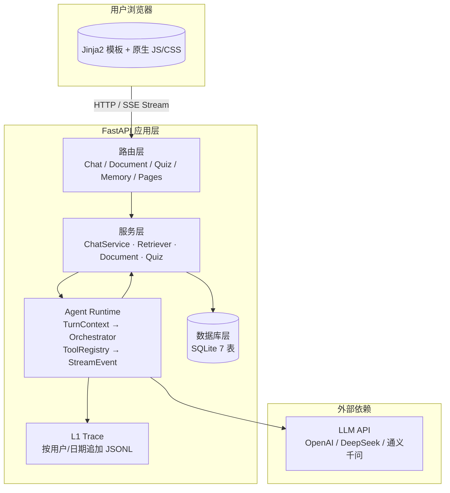
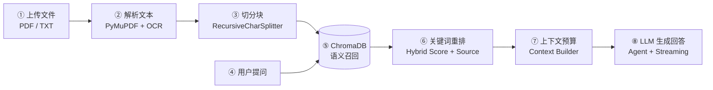

# TutorAI — AI 智能学习助手

[](https://www.python.org/)
[](https://fastapi.tiangolo.com/)
[](https://github.com/astral-sh/ruff)
[](LICENSE)

基于大语言模型的 AI 学习助手，支持**智能对话辅导**、**RAG 文档问答**和**自动出题测试**。

---

## 架构概览



### Agent Runtime 执行链

每次对话先组装成一个 `TurnContext`，再由 `TutorOrchestrator` 校验并路由到当前能力。
`CapabilityRegistry` 管理能力边界，`ToolRegistry` 按能力决定本轮挂载哪些工具，LLM 的工具调用和文本增量统一转换为
`StreamEvent`；HTTP 接口只取其中的 `delta`，所以以后可以无缝增加 WebSocket、调试
面板或异步任务消费者。运行阶段只写入不含 prompt/结果正文的 L1 JSONL 轨迹，便于
排查“调用了哪个工具、在哪一步失败”，同时不把用户原文写进 trace。

```text
TurnContext
    ↓
TutorOrchestrator
    ├── CapabilityRegistry → chat / quiz
    ├── ToolRegistry.for_capability()
    ├── LLM Agent Loop
    │   ├── tool_call / tool_result
    │   └── delta
    └── TraceRecorder → data/traces/<user>/<surface>/<date>.jsonl
```

### RAG 链路（核心面试点）



| 步骤 | 功能 | 文件 | 关键函数 |
|------|------|------|----------|
| ① | 上传文件 | `app/routers/document.py` | `upload_document()` |
| ② | 解析文本 | `app/services/document_parser.py` | `parse_document()` |
| ③ | 切分文本块 | `app/services/document_parser.py` | `chunk_text()` |
| ④ | 用户提问 | `app/routers/document.py` | `query_document()` |
| ⑤ | 语义召回 | `app/services/retriever.py` | `search()` |
| ⑥ | 混合重排与来源 | `app/services/retriever.py` | `search()` |
| ⑦ | 上下文预算 | `app/services/llm_client.py` | `build_chat_messages()` |
| ⑧ | LLM 生成回答 | `app/services/llm_client.py` | `agent_chat()` / `agent_chat_stream()` |

## 技术栈

| 层级 | 技术 | 选型理由 |
|------|------|----------|
| **后端框架** | FastAPI + Uvicorn | 异步性能好，自动生成 Swagger 文档 |
| **前端** | Jinja2 模板 + 原生 JS/CSS | 零构建工具，快速迭代，够用不重 |
| **AI** | OpenAI 兼容 API（LangChain） | 支持 OpenAI / DeepSeek / 通义千问等 |
| **检索** | ChromaDB 语义召回 + 关键词重排 | 兼顾语义泛化与术语精确匹配，并保留来源 |
| **存储** | SQLite（PRAGMA foreign_keys=ON） | 零配置，文件级数据库 |
| **认证** | JWT + bcrypt | 无状态认证，用户数据隔离 |
| **部署** | Docker / Docker Compose | 一键部署，内含 OCR 引擎 |
| **CI** | GitHub Actions | push/PR 自动 pytest + ruff + mypy |
| **代码质量** | ruff + mypy + pyproject.toml | 统一风格，静态类型检查 |

## 功能特性

- **💬 智能对话辅导** — AI 老师多轮对话，支持 Agent 工具调用和流式输出，自动提取对话标题
- **📄 RAG 文档问答** — 上传 PDF/TXT/代码文件，ChromaDB 向量检索 + LLM 生成精准回答，用户数据隔离
- **📝 自动出题** — 输入知识点或上传文档，生成选择题/判断题/填空题/简答题 + 答案解析
- **🔐 用户系统** — JWT 注册/登录，所有数据按用户隔离（Row-Level Security）
- **🔄 流式响应** — 基于 SSE 的逐 token 实时输出
- **🧩 Agent 工具调用** — LLM 可自主调用 `retrieve_document` 工具检索文档
- **🧠 可检查记忆** — 学习目标、偏好、进度可由用户查看/删除，Agent 仅在明确要求时保存
- **🛡️ 上下文边界** — 历史消息、记忆和工具结果均有字符预算，避免长对话失控

## 项目结构

```
app/
├── main.py                 # FastAPI 应用入口（生命周期、中间件、路由注册）
├── config.py               # 配置管理（Pydantic Settings + .env 文件）
├── agent/                   # 统一 Agent Runtime（上下文、编排、工具注册、L1 轨迹）
│   ├── contracts.py         # TurnContext / StreamEvent / AgentResult
│   ├── orchestrator.py      # 一次 turn 的统一执行入口
│   ├── registry.py          # 按 capability 组合工具
│   └── trace.py             # 脱敏 JSONL 执行轨迹
├── db/                     # SQLite 连接、迁移与按用户隔离的仓储
│   ├── engine.py           # 连接管理、建表、迁移、重试
│   ├── memory_repo.py      # 可检查记忆 CRUD
│   └── *_repo.py           # 对话、文档、题目、用户仓储
├── auth.py                 # JWT 令牌生成/验证 + bcrypt 密码哈希
├── models/__init__.py      # Pydantic 请求/响应模型（含校验规则）
├── routers/
│   ├── chat.py             # 对话 CRUD + 流式/同步消息发送
│   ├── document.py         # 文档上传/检索/删除 API（RAG 入口）
│   ├── quiz.py             # 出题生成/保存/历史 API
│   └── pages.py            # 页面路由（首页、登录、注册、出题）
├── services/
│   ├── llm_client.py       # LLM 调用封装（对话/流式/Agent/出题）
│   ├── retriever.py        # ChromaDB 语义召回 + 关键词重排 + 来源
│   ├── document_parser.py  # PDF(PyMuPDF+OCR)/TXT 文本提取
│   ├── tools.py            # LangChain Agent 工具与用户记忆
│   └── rate_limiter.py     # 请求频率限制
├── templates/              # Jinja2 HTML 模板
└── static/                 # CSS + JavaScript
```

## 快速开始

### 本地运行

```bash
# 1. 配置
cp .env.example .env
# 编辑 .env: LLM_API_KEY, LLM_BASE_URL, LLM_MODEL

# 2. 安装
pip install -r requirements.txt

# 3. 启动（默认 http://localhost:8000）
python run.py
```

### Docker 部署

```bash
# 配置 API Key
cp .env.example .env
# 编辑 .env

# 一键启动
docker compose up -d

# 查看日志
docker compose logs -f

# 停止
docker compose down
```

## 测试

```bash
# 全部测试
pytest tests/ -v

# 单独测试模块
pytest tests/test_retriever.py -v    # 检索器测试
pytest tests/test_database.py -v     # 数据库测试
pytest tests/test_chat_api.py -v     # 聊天 API 测试
pytest tests/test_document_api.py -v # 文档 API 测试
pytest tests/test_quiz_api.py -v     # 出题 API 测试
```

## API 文档

启动后访问 `http://localhost:8000/docs` 查看 Swagger 文档。

### 核心接口

| 方法 | 路径 | 说明 |
|------|------|------|
| POST | `/api/auth/register` | 用户注册 |
| POST | `/api/auth/login` | 用户登录 |
| GET | `/api/conversations` | 对话列表 |
| POST | `/api/conversations/{id}/messages` | 发送消息（流式 SSE） |
| POST | `/api/documents/upload` | 上传文档 |
| POST | `/api/documents/{id}/query` | RAG 文档问答 |
| POST | `/api/quiz/generate` | 生成练习题 |
| GET | `/api/memories` | 查看当前用户记忆 |
| POST | `/api/memories` | 手动保存学习记忆 |
| DELETE | `/api/memories/{id}` | 删除当前用户记忆 |
| GET | `/health` | 健康检查（Docker 用） |

## 支持的 LLM 提供商

| 提供商 | `LLM_BASE_URL` |
|--------|----------------|
| OpenAI | `https://api.openai.com/v1` |
| DeepSeek | `https://api.deepseek.com/v1` |
| 通义千问 | `https://dashscope.aliyuncs.com/compatible-mode/v1` |
| 其他兼容 API | 自定义 URL |

## License

MIT License

## 设计来源说明

本项目在架构取舍上参考了 [HKUDS/DeepTutor](https://github.com/HKUDS/DeepTutor)
公开展示的统一 Agent、可检查记忆和多阶段 RAG 思路；本仓库保留轻量 FastAPI + SQLite
实现，新增代码为独立实现，不复制 DeepTutor 源码。
